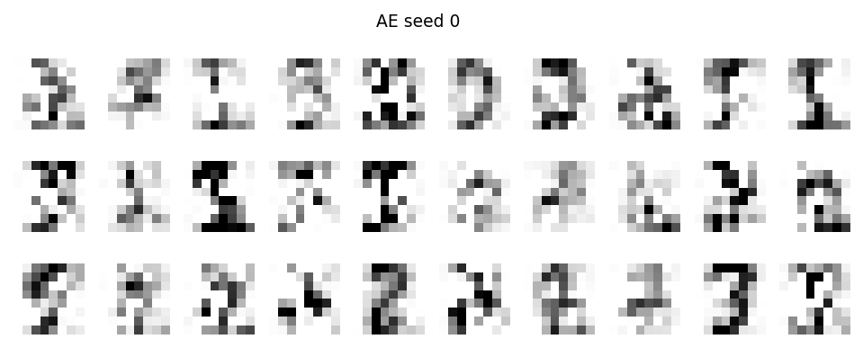
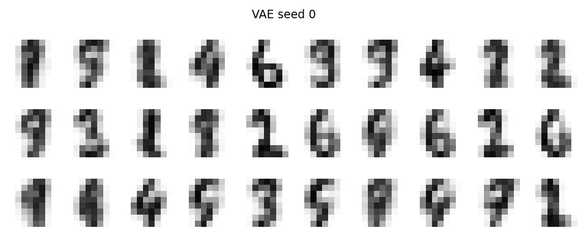

# Latent Spaces
A VAE written from scratch on 8 by 8 digits, compared with a plain autoencoder, varied in the weight on the KL term, probed, and measured.

## Setup
python -m venv .venv
source .venv/bin/activate # Windows: .venv\Scripts\activate
pip install -r requirements.txt

## Run
Open lab07.ipynb, select the python environment, ensure you have installed all the librearies, and run all the cells from top to bottom. Sections are organized under the headers.

## Hardware
GPU: Tesla T4
Time:

## Conventions
Reconstruction loss: Sum over 64 pixels, average over batch.
KL loss: Sum over 8 latent dimensions, average over batch.
Total loss = Reconstruction + β x KL.

## Prediction (written before running the sweep)
Where I expected collapse, which beta I expected to give the best samples, and why.

## Results
### Checks: closed-form against Monte Carlo KL, gradient norms with and without the trick.
KL difference: 0.02042853832244873
Gradient with trick: 0.8507521152496338
Gradient without trick: 0.0
VAE loss: 44.81682586669922
Negative ELBO: 44.81682586669922

### Autoencoder against VAE: per seed, and the code spread.

| Seed | Model | Test MSE | Frechet  | Precision | Recall | Nearest Train |
| ---- | ----- | -------- | -------- | --------- | ------ | ------------- |
| 0    | AE    | 0.0152   | 70.8812  | 0.3510    | 0.8663 | 2.0602        |
| 0    | VAE   | 0.0259   | 12.9154  | 0.9136    | 0.4150 | 1.1303        |
| 1    | AE    | 0.0151   | 87.3034  | 0.3593    | 0.7660 | 2.0956        |
| 1    | VAE   | 0.0265   | 11.3869  | 0.8997    | 0.4680 | 1.1429        |
| 2    | AE    | 0.0149   | 110.7445 | 0.4290    | 0.6574 | 2.3304        |
| 2    | VAE   | 0.0263   | 13.4287  | 0.8830    | 0.4875 | 1.1366        |

KL sweep: every seed, with active units.
Latent path against pixel cross-fade, and conditional VAE shares.
Metric table for the six sets, and Frechet distance against sample size.

## Conclusion
What the VAE gave that the autoencoder did not, what each metric does and does not capture, and what these measurements do and do not establish.

## Known limitations
Anything you are aware of that does not work, or that you would improve with more time.