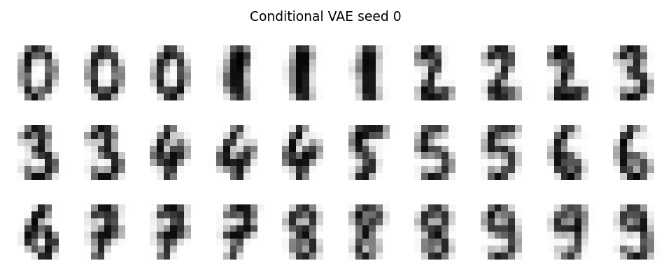

# Latent Spaces
A VAE written from scratch on 8 by 8 digits, compared with a plain autoencoder, varied in the weight on the KL term, probed, and measured.

## Setup
python -m venv .venv
source .venv/bin/activate # Windows: .venv\Scripts\activate
pip install -r requirements.txt

## Run
Open lab07.ipynb, select the python environment, ensure you have installed all the librearies, and run all the cells from top to bottom. Sections are organized under the headers.

## Hardware
GPU: Tesla T4
Time:

## Conventions
Reconstruction loss: Sum over 64 pixels, average over batch.
KL loss: Sum over 8 latent dimensions, average over batch.
Total loss = Reconstruction + β x KL.

## Prediction (written before running the sweep)
I expect beta = 4 to collapse, because it is the highest weight being tested and the other weights seem more balacned.
Furthermoe, I think that beta = 0.5 will give the best samples because it balances reconstruction and KL regularization.

## Results
### Checks
KL difference: 0.02042853832244873
Gradient with trick: 0.8507521152496338
Gradient without trick: 0.0
VAE loss: 44.81682586669922
Negative ELBO: 44.81682586669922

All checks passed

### Autoencoder against VAE

| Seed | Model | Test MSE | Frechet  | Precision | Recall | Nearest Train |
| ---- | ----- | -------- | -------- | --------- | ------ | ------------- |
| 0    | AE    | 0.0152   | 70.8812  | 0.3510    | 0.8663 | 2.0602        |
| 0    | VAE   | 0.0259   | 12.9154  | 0.9136    | 0.4150 | 1.1303        |
| 1    | AE    | 0.0151   | 87.3034  | 0.3593    | 0.7660 | 2.0956        |
| 1    | VAE   | 0.0265   | 11.3869  | 0.8997    | 0.4680 | 1.1429        |
| 2    | AE    | 0.0149   | 110.7445 | 0.4290    | 0.6574 | 2.3304        |
| 2    | VAE   | 0.0263   | 13.4287  | 0.8830    | 0.4875 | 1.1366        |

The AE reconstructed better, but the VAE generated better samples from random codes.

### KL sweep: every seed, with active units
| Beta | Seed | Reconstruction | KL      | Active Dimensions | Frechet  | Precision | Recall |
| ---- | ---- | -------------- | ------- | ----------------- | -------- | --------- | ------ |
| 0.1  | 0    | 16.6792        | 14.2478 | 8                 | 10.2701  | 0.7437    | 0.8468 |
| 0.1  | 1    | 16.5469        | 14.1241 | 8                 | 13.9883  | 0.6964    | 0.8719 |
| 0.1  | 2    | 16.6033        | 14.2789 | 8                 | 9.5870   | 0.6825    | 0.8217 |
| 0.5  | 0    | 18.7538        | 5.8431  | 7                 | 9.5251   | 0.8189    | 0.7131 |
| 0.5  | 1    | 18.7185        | 5.9717  | 7                 | 7.3731   | 0.8552    | 0.7326 |
| 0.5  | 2    | 18.5739        | 6.1659  | 7                 | 8.8399   | 0.8440    | 0.7911 |
| 1.0  | 0    | 20.4055        | 3.5089  | 5                 | 12.9154  | 0.9136    | 0.4150 |
| 1.0  | 1    | 20.7338        | 3.2489  | 5                 | 11.3869  | 0.8997    | 0.4680 |
| 1.0  | 2    | 20.6249        | 3.3195  | 5                 | 13.4287  | 0.8830    | 0.4875 |
| 2.0  | 0    | 23.8451        | 1.2772  | 3                 | 43.7567  | 0.9415    | 0.0613 |
| 2.0  | 1    | 24.0199        | 1.1763  | 3                 | 44.3058  | 0.9359    | 0.1170 |
| 2.0  | 2    | 23.8129        | 1.2776  | 4                 | 41.0064  | 0.9415    | 0.1031 |
| 4.0  | 0    | 27.0889        | 0.0012  | 0                 | 218.6080 | 1.0000    | 0.0000 |
| 4.0  | 1    | 27.0863        | 0.0011  | 0                 | 220.0111 | 1.0000    | 0.0000 |
| 4.0  | 2    | 27.0811        | 0.0005  | 0                 | 224.0644 | 1.0000    | 0.0000 |

### Latent path
**Interpolation Results**
| Seed | Method | Confidence | Class Changes |
|---|---|---:|---:|
| 0 | AE | 0.9261 | 70 |
| 0 | VAE | 0.9287 | 63 |
| 0 | Pixel | 0.9338 | 51 |
| 1 | AE | 0.9276 | 63 |
| 1 | VAE | 0.9287 | 61 |
| 1 | Pixel | 0.9338 | 51 |
| 2 | AE | 0.9248 | 69 |
| 2 | VAE | 0.9298 | 63 |
| 2 | Pixel | 0.9338 | 51 |

Pixel cross-fading performed best across all three seeds, with the highest confidence and fewest class changes. The VAE performed slightly better than the AE but did not beat pixel cross-fading.

**Conditional VAE Results**
The feature network classified the generated images as the requested digit at the following rates:

| Seed | Requested-digit share |
|---|---|
| 0 | 99.9% average (99.5% for digits 0 and 8, 100% for others) |
| 1 | 100% for every digit |
| 2 | 100% for every digit |

**Unconditional VAE Class Counts (1,000 samples per seed)**
| Seed | 0 | 1 | 2 | 3 | 4 | 5 | 6 | 7 | 8 | 9 |
|---|---|---|---|---|---|---|---|---|---|---|
| 0 | 90 | 83 | 78 | 135 | 94 | 87 | 126 | 109 | 119 | 79 |
| 1 | 97 | 78 | 80 | 119 | 97 | 111 | 114 | 76 | 133 | 95 |
| 2 | 95 | 96 | 88 | 140 | 95 | 94 | 88 | 89 | 111 | 104 |

The conditional VAE successfully generated the requested digits nearly 100% of the time, while the unconditional VAE generated a mixture of digits with uneven class counts. This shows that conditioning gives more control over the generated digit.

### Metric table for the six sets
| Seed | Image Set | Fréchet | Precision | Recall | Nearest Train |
|---|---|---:|---:|---:|---:|
| 0 | Real training | 2.1426 | 0.9331 | 0.8886 | 0.0000 |
| 0 | Copier | 2.2121 | 0.9331 | 0.8663 | 0.1336 |
| 0 | Mean image + noise | 138.4172 | 0.9387 | 0.0000 | 1.6170 |
| 0 | Collapsed VAE | 218.6080 | 1.0000 | 0.0000 | 1.5096 |
| 0 | VAE beta=1 | 12.9154 | 0.9136 | 0.4150 | 1.1303 |
| 0 | AE prior | 70.8812 | 0.3510 | 0.8663 | 2.0602 |
| 1 | Real training | 2.0285 | 0.9415 | 0.9304 | 0.0000 |
| 1 | Copier | 2.1715 | 0.9443 | 0.9304 | 0.1333 |
| 1 | Mean image + noise | 138.8226 | 0.9610 | 0.0000 | 1.6145 |
| 1 | Collapsed VAE | 220.0111 | 1.0000 | 0.0000 | 1.5067 |
| 1 | VAE beta=1 | 11.3869 | 0.8997 | 0.4680 | 1.1429 |
| 1 | AE prior | 87.3034 | 0.3593 | 0.7660 | 2.0956 |
| 2 | Real training | 2.1371 | 0.9304 | 0.9136 | 0.0000 |
| 2 | Copier | 2.1278 | 0.9276 | 0.8969 | 0.1335 |
| 2 | Mean image + noise | 137.5973 | 0.9499 | 0.0000 | 1.6219 |
| 2 | Collapsed VAE | 224.0644 | 1.0000 | 0.0000 | 1.5140 |
| 2 | VAE beta=1 | 13.4287 | 0.883

The VAE had lower Frehet distances than the AE across all three seeds.
The copier scored almost as well as real images, even though it copied training images.
The collapsed VAE had perfect precision (1.0000) but zero recall, showing that precision cannot measure variety.Nearest-training distance helped identify copied images.

## Conclusion
The VAE generated better images from random codes than the AE, but the AE reconstructed images better. Frechet distance measures overall similarity, precision measures realism, recall measures variety, and nearest-training distance helps detect copying. However, no single metric measures everything. These results show how the models perform on this dataset, but not how they would perform on larger datasets.

## Known limitations
The experiments only used 8×8 digit images, one small architecture, and three seeds. The VAE also collapsed at β=4, and latent interpolation did not beat pixel cross-fading. With more time, I would test larger datasets, different architectures, and use more seeds.